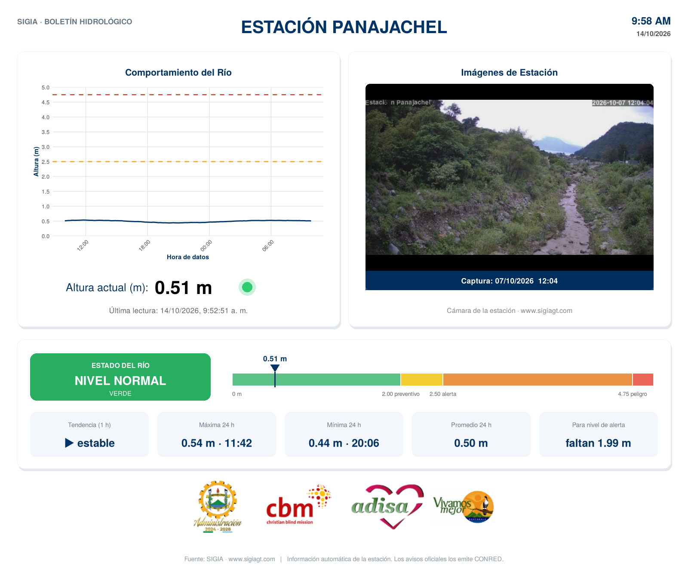
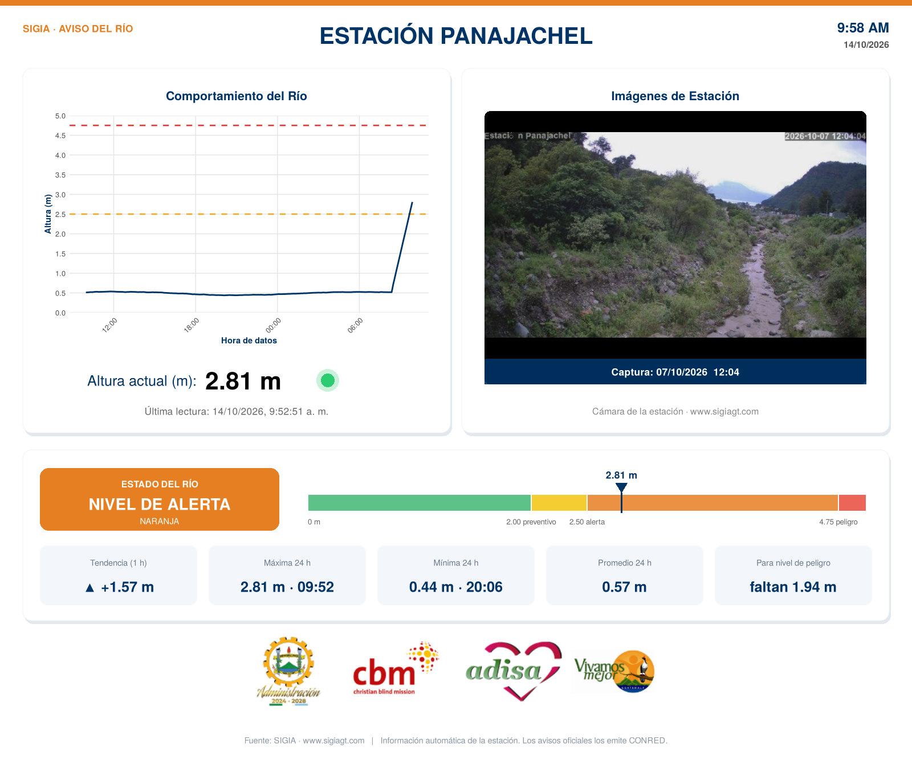
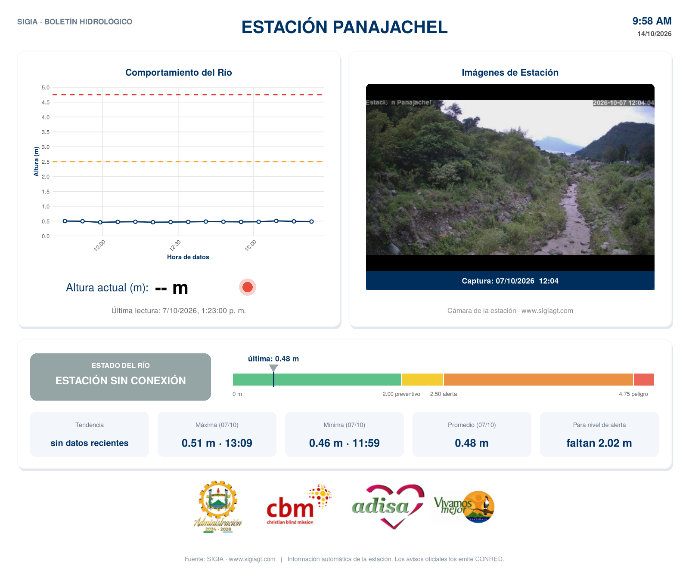

# 🌊 SIGIA · Monitor de Ríos para Telegram

Lee la altura del río de las estaciones de [SIGIA](https://www.sigiagt.com/index.html) y publica en un canal de Telegram boletines, alertas y un resumen semanal. Cada mensaje es una **tarjeta-imagen con el mismo diseño de la página de la estación**: gráfica, cámara, altura actual y logos, más el semáforo, un medidor de nivel y estadísticas.

| Boletín normal | Alerta | Estación sin conexión |
|---|---|---|
|  |  |  |

*Ejemplos con datos simulados.*

## Qué hace

| Mensaje | Cuándo | Dónde |
|---|---|---|
| **Boletín hidrológico** | 06:07, 12:07 y 18:07 · sin sonido | Canal |
| **Alerta** | En cuanto pasa algo (revisión cada 10 min) · con sonido | Canal |
| **Resumen semanal** | Lunes 07:05 · sin sonido | Canal |
| **Avisos técnicos** | Estación caída o de regreso, cámara sin fotos, sensor con lecturas falsas | Chat privado del equipo |
| **Copia para WhatsApp** | Con cada alerta | Chat privado del equipo |
| **Nota de voz** | Con cada boletín y alerta: una voz de Guatemala lee el nivel, la tendencia y qué hacer | Canal |

### Alertas

| Nivel | Altura (Panajachel) | Qué pasa |
|---|---|---|
| 🟢 Normal | menos de 2.00 m | Solo boletines |
| 🟡 Preventivo | 2.00 – 2.50 m, o subida de 0.15 m en 30 min | Aviso en el canal |
| 🟠 Alerta | 2.50 – 4.75 m | Alerta con sonido, se fija en el canal |
| 🔴 Peligro | 4.75 m o más | Alerta con sonido, se fija en el canal |
| 🌧️ Lluvia | 20 mm o más en 1 h en la cuenca alta | Aviso preventivo (si se configura) |
| ✅ Normalidad | El río baja de 2.00 m | Aviso y se desfija la alerta |

Cada alerta incluye:
- **Proyección:** *"a este ritmo alcanzaría el nivel de peligro en ≈ 45 min"*.
- **Qué hacer:** una recomendación según el nivel.
- **Emergencias:** CONRED 1566 · Bomberos 122 / 123 · PNC 110.
- Si están configurados, el **texto en kaqchikel** y las **notas de voz**.

**Protección contra alertas falsas:**
- Se descartan las lecturas imposibles y los picos aislados del sensor.
- Para alertar, el nivel debe sostenerse **2 lecturas seguidas**.
- No se repite la misma alerta: vuelve a avisar solo si el río sigue subiendo, cambia de nivel o regresa a normal.

## Puesta en marcha

### 1. Subir a GitHub
Suba **todo el contenido** de esta carpeta a un repositorio, incluida la carpeta oculta `.github`. Use un repositorio **público**: así GitHub Actions es gratis sin límite de minutos, y el código no contiene contraseñas.

### 2. Secretos
En **Settings → Secrets and variables → Actions → New repository secret**:

| Secreto | | Qué es |
|---|---|---|
| `TELEGRAM_TOKEN` | **obligatorio** | Token del bot (de @BotFather) |
| `ADMIN_CHAT_ID` | **recomendado** | Chat privado del equipo técnico. Para saber el número, escríbale a **@userinfobot**. Para un grupo, agregue el bot al grupo. |
| `TELEGRAM_CHAT_ID` | opcional | Canal público. Si falta, se usa el de `config.R`. |
| `WU_API_KEY` | opcional | Llave de Wunderground, para la lluvia de la cuenca |
| `GOOGLE_TTS_KEY` | recomendado | Llave de Google Text-to-Speech para la voz más natural (Chirp 3 HD). Gratis para este uso. Sin ella se usa la voz de Microsoft. |

### 3. Permisos del bot
El bot debe ser **administrador del canal**, con permiso para **publicar** y **fijar mensajes**.

### 4. Probar
Vaya a la pestaña **Actions** → **Boletín de ríos** → **Run workflow**. En 2–3 minutos debe llegar el boletín al canal. Después active los demás workflows.

## Configuración

Todo se ajusta en **`config.R`**: umbrales, tiempos, estaciones de lluvia, número de emergencias y estaciones activas. Los valores principales son:

| Valor | Por defecto | Para qué |
|---|---|---|
| `umbral_preventivo` / `umbral_alerta` / `umbral_peligro` | 2.00 / 2.50 / 4.75 m | Niveles del semáforo |
| `subida_minima` en `ventana_min` | 0.15 m en 30 min | Aviso de "el río está subiendo" |
| `confirmar_lecturas` | 2 | Lecturas seguidas para alertar (la estación lee cada 10 min) |
| `salto_max` | 0.50 m | Salto entre lecturas que, si no se repite, es lectura falsa |
| `lluvia` | vacío | Estaciones Wunderground de la parte alta de la cuenca |
| `bot_usuario` | vacío | Usuario del bot, para mostrar el botón "Consultar nivel al bot" |
| `voz` | Google `es-US-Chirp3-HD-Aoede` (respaldo: `es-GT-MartaNeural`) | Nota de voz automática: activar/desactivar, elegir voz y velocidad |

**Agregar Camotán:** en `config.R` está preparada pero desactivada. Hay que confirmar los nombres de sus archivos de datos y sus umbrales (ver instrucciones en el archivo) y cambiar `activa = TRUE`.

## Herramientas adicionales

| | Cómo |
|---|---|
| **Ajustar umbrales con el historial** | Actions → **Análisis de umbrales** → Run workflow. Descarga todo el historial y genera un reporte con los días más altos, las subidas típicas y valores sugeridos, que se descargan desde la ejecución (*Artifacts*). Los umbrales finales deben validarse con COMRED. |
| **Bot de consulta `/nivel`** | Responde al instante a quien le escriba. Instrucciones en [`apps_script/LEEME.md`](apps_script/LEEME.md). |
| **Alertas en kaqchikel** | Una persona hablante llena [`textos/kaqchikel.json`](textos/kaqchikel.json) y cambia `"activo": true`. |
| **Notas de voz** | Grabaciones en la carpeta `audios/`. Ver [`audios/LEEME.md`](audios/LEEME.md). |

## Horarios (GitHub usa hora UTC; Guatemala = UTC−6)

| Workflow | Archivo | Hora de Guatemala |
|---|---|---|
| Boletín de ríos | `boletin.yml` | 06:07, 12:07, 18:07 |
| Alertas de ríos | `alerta.yml` | cada 10 min |
| Resumen semanal | `semanal.yml` | lunes 07:05 |
| Análisis de umbrales | `analisis.yml` | solo manual |

GitHub puede atrasar unos minutos las tareas programadas cuando está saturado. Si GitHub falla, le enviará un correo al dueño del repositorio; los errores del script también llegan al chat del equipo.

## Uso en una computadora (opcional)

```bash
# Archivo .Renviron en esta carpeta (nunca se sube a GitHub):
#   TELEGRAM_TOKEN=...
#   ADMIN_CHAT_ID=...
Rscript sigia_monitor.R boletin
Rscript sigia_monitor.R alerta
Rscript sigia_monitor.R semanal
Rscript sigia_monitor.R boletin panajachel   # solo una estación
Rscript analizar_umbrales.R panajachel 2026-02-01
```

Paquetes: `install.packages(c("httr", "jsonlite", "ggplot2", "png", "jpeg"))`

## Archivos

| Archivo | Para qué |
|---|---|
| `config.R` | **Configuración** (el único que normalmente se edita) |
| `sigia_monitor.R` | Script principal |
| `analizar_umbrales.R` | Análisis del historial |
| `estado/` | Memoria de las alertas, para no repetirlas. La actualiza GitHub solo; no la borre. |
| `textos/` | Traducciones de las alertas |
| `audios/` | Notas de voz de las alertas |
| `apps_script/` | Bot de consulta `/nivel` |
| `.github/workflows/` | Tareas programadas de GitHub |
| `DESCRIPTION` | Paquetes de R que instala GitHub |

---
*Información automática de las estaciones de monitoreo SIGIA. Los avisos oficiales los emite CONRED.*
